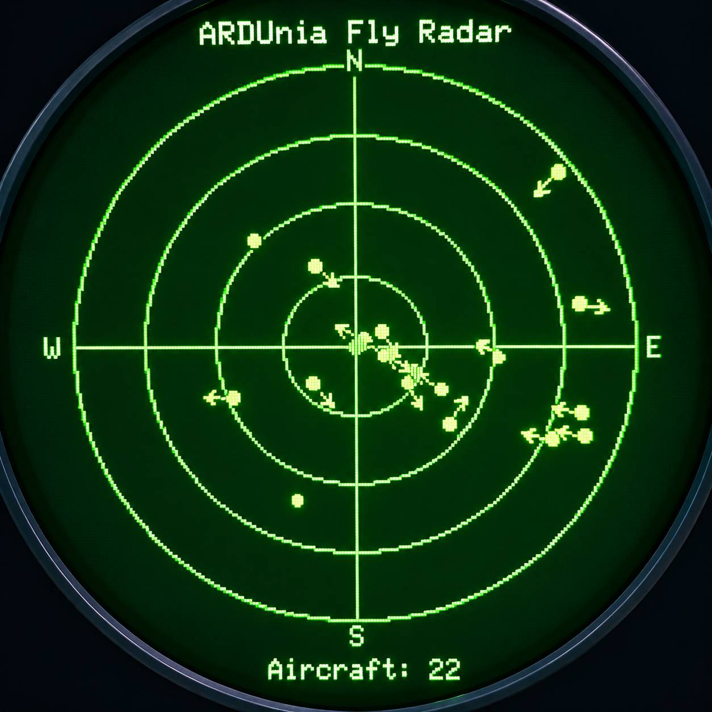
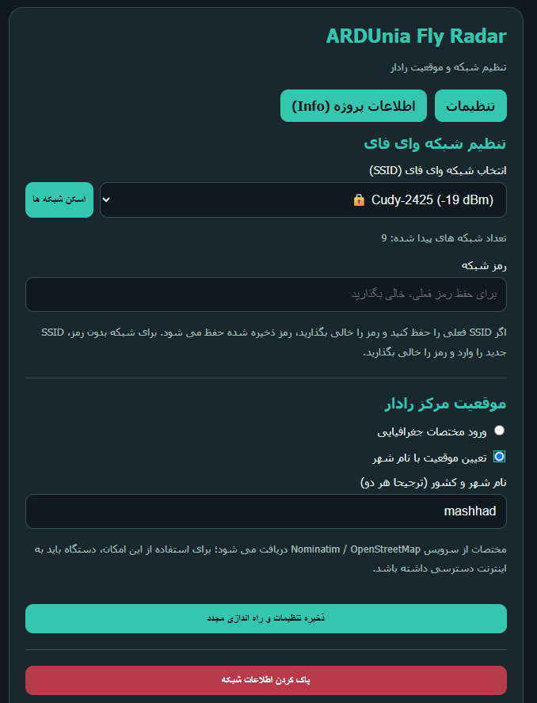
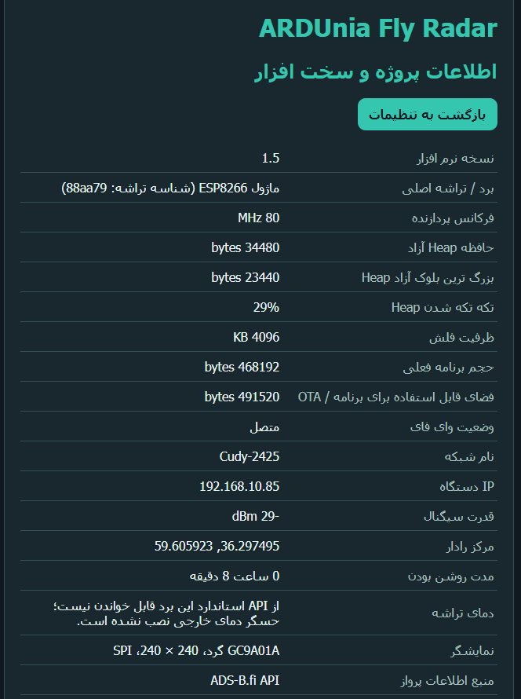

# ARDUnia Fly Radar

**A compact live-aircraft radar for ESP8266 and a 240 × 240 GC9A01 round display.**

ARDUnia Fly Radar retrieves nearby aircraft positions from the ADS-B data service and plots aircraft within a 40-nautical-mile radius around a configurable location. A built-in web interface lets you configure Wi-Fi and the radar center from a phone or computer.

> **Current release:** v1.5  
> **Platform:** ESP8266 / NodeMCU  
> **Display:** GC9A01, 240 × 240, round TFT

## Features

- Circular radar view with range rings, cardinal directions, aircraft markers, and heading indicators when track data is available.
- 40 NM radar radius, refreshed approximately every 15 seconds.
- First-run Wi-Fi setup access point and browser-based configuration page.
- Nearby Wi-Fi network scanning and selection from the setup page.
- Radar center configuration by latitude/longitude or by city name.
- Settings stored in EEPROM so Wi-Fi credentials and radar location survive restart.
- Device information page and option to clear saved network settings.
- Teal ARDUnia intro/setup interface.

## Preview

### Radar display concept



This image is a visual concept/reference for the round radar display.

### Web configuration



### Device information page



## Hardware

- ESP8266 NodeMCU development board
- GC9A01 round TFT display, 240 × 240 pixels
- USB power supply and suitable wiring

### Display wiring

The sketch uses **GPIO numbers**, not NodeMCU `D` labels.

| GC9A01 signal | ESP8266 GPIO |
|---|---:|
| CS | GPIO4 |
| DC | GPIO5 |
| RST | GPIO16 |
| SCLK / SCL | Hardware SPI clock (GPIO14 on standard NodeMCU) |
| MOSI / SDA | Hardware SPI MOSI (GPIO13 on standard NodeMCU) |
| VCC | According to the display module specification |
| GND | GND |

The display's SPI clock and MOSI are provided by the ESP8266 hardware SPI interface. Do not connect the display's MISO unless your particular module requires it. Check your board and display-module pin labels before powering the circuit.

## Software requirements

Install the ESP8266 board platform in Arduino IDE and select the appropriate NodeMCU ESP8266 board.

Libraries used by the sketch:

- [ArduinoJson](https://arduinojson.org/) — JSON parsing (the sketch uses the ArduinoJson 6-style `DynamicJsonDocument` API)
- [Adafruit GFX Library](https://github.com/adafruit/Adafruit-GFX-Library)
- [Adafruit GC9A01A](https://github.com/adafruit/Adafruit_GC9A01A)

The following are provided by the ESP8266 Arduino core and do not need separate library installs: `ESP8266WiFi`, `ESP8266HTTPClient`, `WiFiClientSecure`, `ESP8266WebServer`, and `EEPROM`.

## Getting started

1. Install the ESP8266 board package and the libraries listed above.
2. Open `ARDUnia_Fly_Radar_v1_5.ino` in Arduino IDE.
3. Select the correct ESP8266 board and serial port.
4. Upload the sketch.
5. On first setup, connect a phone or computer to the Wi-Fi access point named **`ARDUnia-Fly-Radar-Setup`**.
6. Open **http://192.168.4.1** in a browser.
7. Scan for nearby Wi-Fi networks, select your network, and enter its password.
8. Set the radar center using coordinates or the city lookup option, then save the settings. The device restarts and attempts to connect to the configured network.

If the device cannot connect using saved settings, use the setup workflow to configure it again. The web page also provides an option to clear the saved network configuration.

## Data sources and connectivity

- Aircraft data: [adsb.fi Open Data API](https://opendata.adsb.fi/)
- City-name lookup: [OpenStreetMap Nominatim](https://nominatim.openstreetmap.org/)

Internet access is required for live aircraft data and city-name lookup. Availability and coverage depend on the upstream data services and local receiver coverage. Aircraft positions can be delayed, incomplete, or unavailable.

### Security note

The initial configuration access point is open and the sketch uses `WiFiClientSecure::setInsecure()` for HTTPS clients. This means server certificates are not validated by the firmware. Use the setup access point only in a trusted environment, and do not treat the current network implementation as hardened security.

## Configuration and operation

- **Radar radius:** 40 nautical miles (`RADAR_RANGE_NM` and API distance path).
- **Refresh interval:** 15 seconds (`UPDATE_INTERVAL`).
- **Radar center:** saved latitude and longitude.
- **Wi-Fi:** credentials stored in EEPROM.

Change these constants only if you understand the effects on display scaling, API requests, and device memory.

## Repository layout

```text
ARDUnia-Fly-Radar/
├── ARDUnia_Fly_Radar_v1_5.ino
├── LICENSE
├── README.md
└── docs/
    ├── HARDWARE.md
    ├── SETUP.md
    └── images/
        ├── device-info.png.jpeg
        ├── radar-display-concept.png.jpeg
        └── web-setup.png.jpeg
```

## Troubleshooting

- **Setup access point is not visible:** restart the board and check the serial output and power supply.
- **Browser page does not open:** connect to `ARDUnia-Fly-Radar-Setup` first, then navigate to `http://192.168.4.1`.
- **No aircraft appear:** verify Wi-Fi connectivity and the configured radar center. The upstream API may have no reports for the selected area or may be temporarily unavailable.
- **Display is blank or corrupted:** recheck CS/DC/RST wiring, hardware SPI clock/MOSI, power, and the selected board.
- **Compilation fails on ArduinoJson:** install a version compatible with the ArduinoJson 6 API used by this sketch.

## Author and project links

Created by **Hamidreza Milaninia** for **ARDUnia**.

- **ARDUnia projects and documentation:** [ardunia.ir](https://ardunia.ir)
- **Personal / professional website:** [hrmnia.com](https://hrmnia.com)
- **GitHub organization:** [github.com/ardunia](https://github.com/ardunia)
- **Project repository:** [ARDUnia-Fly-Radar](https://github.com/ARDUnia/ARDUnia-Fly-Radar)

Aircraft and geocoding data are provided by third-party services. This project is an independent hobby/learning project and is not affiliated with or endorsed by those services.

## Hardware safety and liability disclaimer

This project is provided **“as is”** for educational and experimental use. Building, wiring, modifying, or operating electronic hardware may cause damage to the board, display, other components, connected equipment, or property, and may cause injury. **The author accepts no responsibility for hardware damage, component failure, wiring mistakes, power-supply issues, or other losses resulting from assembling, modifying, or using this project. You build and use the hardware at your own risk.**

Before applying power, verify all pin connections, voltage levels, current requirements, polarity, and the specifications of your particular ESP8266 board and display module. Do not assume that every module sold under the same name has identical electrical requirements.

## License

This project is licensed under the **MIT License**. See the [LICENSE](LICENSE) file for the full license text.
